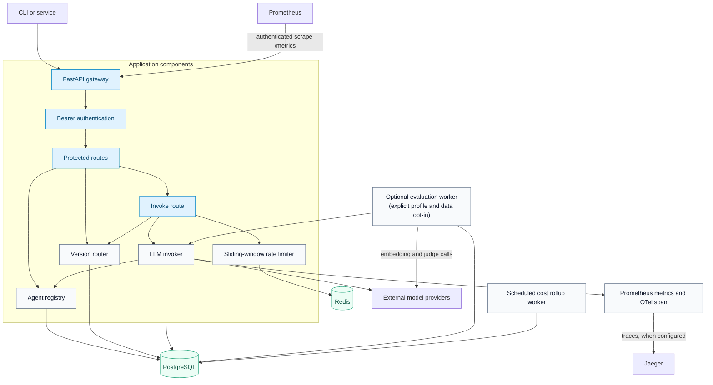
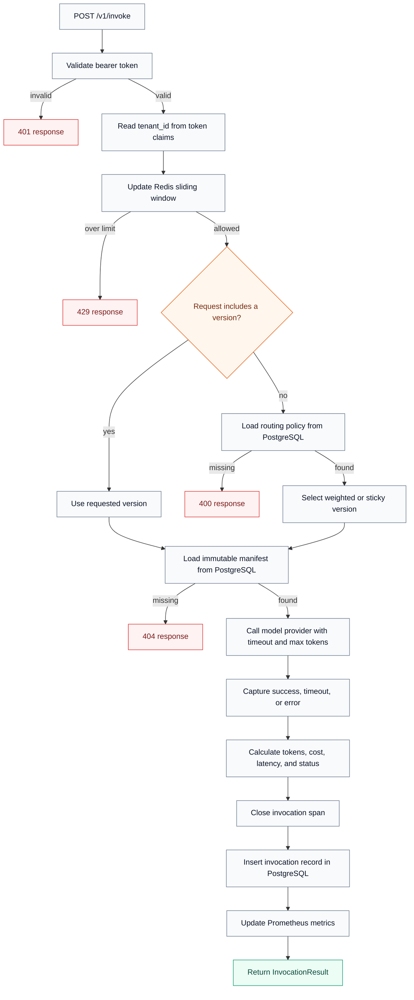

# AgentOps-360

[](https://github.com/didier-lioniello/AgentOps-360/actions/workflows/ci.yml)
[](https://github.com/didier-lioniello/AgentOps-360/actions/workflows/codeql.yml)

**A reference implementation of an LLM agent control plane.** It demonstrates a versioned registry,
traffic routing, cost and latency tracking, scheduled evaluation, and observability hooks behind a
FastAPI gateway.

> This is a public portfolio and learning project, not a production-ready service. The
> [known limitations](#known-limitations) are part of the design documentation.

---

## Why this exists

Most teams shipping LLM features eventually hit the same wall:

- **No version control** for agents — prompts and tool configs live in app code, untraceable.
- **No safe rollout** — switching from `gpt-4o` to `gpt-4o-mini` is a YOLO deploy.
- **No cost visibility** — bills explode and nobody knows which agent or tenant is responsible.
- **No regression detection** — a "small prompt fix" silently degrades quality on a slice of traffic.

AgentOps-360 explores these concerns in a compact implementation that can be read, tested, and
extended without exposing any private product code.

---

## Architecture

This is a logical component view. Scheduled workers reuse the same Python components directly;
they do not call the HTTP gateway.



---

## End-to-end invocation workflow

This is the implemented request path for `POST /v1/invoke`; model timeouts and provider errors are
recorded as invocation outcomes rather than presented as a successful model response.



---

## Core capabilities

### 1. Versioned agent registry
Every agent is a `(name, version, manifest)` triple. The manifest declares model, system prompt,
tools, eval dataset, and cost guardrails. Manifests are immutable once published — you publish
a new version, you don't mutate.

### 2. Declarative routing
The authenticated routing API accepts JSON policies such as
[`examples/routing/orders_canary.json`](examples/routing/orders_canary.json):

```json
{
  "agent": "orders-classifier",
  "strategy": "canary",
  "versions": [
    {"version": "1.0.0", "weight": 90},
    {"version": "1.1.0-canary", "weight": 10}
  ],
  "sticky_by": "tenant_id"
}
```

`PUT /v1/routing/orders-classifier` stores the policy in PostgreSQL. Requests without an explicit
version read that policy and select a weighted or sticky version without a code redeploy.

### 3. Per-tenant cost & rate accounting
Every invocation is metered: input/output tokens, model cost, latency, status. Aggregates roll
up by `(tenant_id, agent, version, day)`. A Redis-backed sliding window enforces request-rate
limits per authenticated tenant.

### 4. Continuous evaluation
A separately enabled worker can re-run active versions that reference a stored golden dataset.
Regressions (drop beyond a tolerance with non-overlapping bootstrap CIs) produce a structured
warning for an external alerting integration to consume. It is disabled by default because this
flow sends dataset inputs to the invoked model provider, then sends model outputs and expected
answers to the configured embedding and judge providers.

### 5. Observability hooks
- **Traces**: FastAPI instrumentation plus an OpenTelemetry span around model invocation.
- **Metrics**: bearer-protected Prometheus counters and histograms for invocations, latency, errors,
  tokens, rate limits, and evaluations. Tenant labels and cost totals are deliberately excluded.
- **Logs**: structured worker events, including evaluation regression warnings.

Invocation spans also omit tenant identifiers. Public request models bound prompt, metadata,
manifest, tool-schema, token, and timeout sizes before provider work is scheduled.

---

## Quickstart

Prerequisites: Docker with the Compose plugin and `curl`. `jq` is only required for the bundled
shell demo. The registry, routing API, health checks, PostgreSQL, Redis, Jaeger, and Prometheus can
start without a model credential; invoking an agent requires a valid `OPENAI_API_KEY`.

```bash
git clone https://github.com/didier-lioniello/AgentOps-360
cd AgentOps-360
cp .env.example .env
docker compose up --build -d --wait --wait-timeout 120
curl -fsS http://localhost:8000/health
```

The example environment explicitly enables local development authentication. Its static token is
intended only for the loopback-bound Docker demo and must not be reused in a deployment. The same
demo token configures Prometheus in `ops/prometheus.yml`; update both files if you change it.
Register an agent with the tenant carried by that token:

```bash
DEMO_TOKEN=local-demo-token-only

# Register version 1.0.0 of an agent
curl -X POST http://localhost:8000/v1/agents \
  -H "Authorization: Bearer ${DEMO_TOKEN}" \
  -H "Content-Type: application/json" \
  -d @examples/agents/orders_classifier_v1.json

# Add OPENAI_API_KEY to .env, recreate the API, then invoke a real model.
# docker compose up -d --force-recreate api
curl -X POST http://localhost:8000/v1/invoke \
  -H "Authorization: Bearer ${DEMO_TOKEN}" \
  -H "Content-Type: application/json" \
  -d '{"agent":"orders-classifier","version":"1.0.0","input":"my order #4421 never arrived"}'
```

Tenant identity always comes from the authenticated token. An `X-Tenant-Id` header is not used and
cannot override the signed/configured tenant. In `AUTH_MODE=jwt`, tokens must contain valid `aud`,
`exp`, `sub`, and `tenant_id` claims; `JWT_SECRET` must be a non-placeholder value of at least 32
characters.

Invocation prompts and model responses are persisted as `[redacted]` by default, and provider
exception details are replaced with a generic error. `STORE_INVOCATION_CONTENT=true` is an explicit
opt-in for local debugging only; enabling it creates sensitive database records that require an
appropriate retention, access-control, and deletion policy.

The Compose quickstart does not start the evaluation worker. Evaluation requires both the
`evaluation` Compose profile and `ALLOW_EXTERNAL_EVAL_DATA=true`. Enabling it authorizes dataset
inputs, expected answers, and model outputs to leave the local stack for the configured invocation,
embedding, and judge providers:

```bash
# First review the dataset and provider data-retention terms, then change the flag in .env.
docker compose --profile evaluation up --build -d eval-worker
```

To run the unit tests and lint checks without Docker or external services:

```bash
python -m venv .venv
source .venv/bin/activate
python -m pip install -r requirements.txt
python -m pip install "ruff==0.16.3"
ruff check .
ruff format --check .
python -m pytest
```

---

## Evidence

- **CI definition:** [`.github/workflows/ci.yml`](.github/workflows/ci.yml) makes Ruff lint/format,
  shell syntax, dependency-lock verification, dependency auditing, and the Python 3.11/3.12 pytest
  matrix blocking before the Docker image build. [CodeQL](.github/workflows/codeql.yml) analyzes
  Python on pushes, pull requests, and a weekly schedule. [Dependency review](.github/workflows/dependency-review.yml)
  blocks pull requests that introduce moderate-or-higher known dependency vulnerabilities.
- **Tests:** [`tests/test_auth.py`](tests/test_auth.py) covers token-derived tenant selection,
  header-override rejection, explicit development credentials, and unsafe JWT configuration.
  [`tests/test_health_metrics.py`](tests/test_health_metrics.py) covers readiness failure status and
  metrics authentication/redaction. [`tests/test_invoker_registry_policy.py`](tests/test_invoker_registry_policy.py)
  covers content redaction, sanitized provider errors, status lifecycle, and routing-policy
  integrity. [`tests/test_eval_worker.py`](tests/test_eval_worker.py) covers invocation commits,
  failed outcomes, the external-data gate, and metric failures. [`tests/test_eval_metrics.py`](tests/test_eval_metrics.py)
  verifies provider failures remain failures instead of becoming plausible scores. The rest of
  [`tests/`](tests/) exercises bounded request/manifest validation, routing, cost calculation, and
  evaluation bootstrap behavior; external-service integration remains a documented limitation.
- **Health checks:** [`/health` and `/ready`](api/routes/health.py) separate process liveness from
  PostgreSQL schema/Redis readiness; `/ready` returns HTTP 503 while degraded. The
  [container health check](Dockerfile) probes `/health`.

---

## Stack

| Layer | Choice | Why |
|---|---|---|
| API | FastAPI + Uvicorn | Async, OpenAPI out of the box, Pydantic v2 |
| Persistence | Postgres 16 | Relational integrity for invocations + registry |
| Rate limiting | Redis 7 | Sliding-window request counts |
| Tracing | OpenTelemetry → Jaeger | Vendor-neutral |
| Metrics | Prometheus | Authenticated pull endpoint without tenant or cost labels |
| Auth | Explicit local mode or HS256 JWT | Reference boundary; replace with OIDC/JWKS in production |
| LLM SDK | langchain-openai | Easy to swap providers |

---

## Repo layout

```
api/         FastAPI app, routes, deps, auth
core/        registry, router, invoker, cost, tracing
models/      Pydantic + ORM schemas
workers/     async eval worker, cost aggregator
db/          schema.sql + connection pool
eval/        eval runner, metric stack
tests/       pytest unit tests
ops/         prometheus.yml, grafana dashboard
examples/    sample manifests + curl scripts
```

---

## Known limitations

- Authentication is deliberately small: the JWT mode uses one HS256 secret and has no OIDC/JWKS,
  key rotation, roles, or permission model. Development auth is an explicit local-only mode.
- Invocation-record and cost read endpoints are tenant-filtered, but the agent registry and routing
  policies are global. Do not expose this implementation to mutually untrusted tenants.
- Request-rate limiting is implemented; cost budgets and the manifest's per-call cost ceiling are
  not enforced on the request path.
- The opt-in evaluation worker logs regression findings. It does not create issues or page an
  operator, and enabling it sends evaluation content to configured external providers.
- Database setup uses an idempotent SQL file rather than a migration lifecycle.
- The current tests are unit tests. Database, Redis, model-provider, worker, and full Compose flows
  still need integration coverage.
- The included Compose credentials and observability endpoints are intended only for a local
  demonstration. Published ports bind to `127.0.0.1`; this is not a deployment security boundary.
- The demo image runs one Uvicorn worker because its Prometheus registry is process-local. A
  multi-worker deployment needs a supported multiprocess or external metrics design.
- [`requirements.txt`](requirements.txt) is compiled and pinned from direct dependencies in
  [`requirements.in`](requirements.in). Hashes are intentionally omitted to keep routine updates
  reviewable, so package-index integrity is not cryptographically enforced by pip.

If adapting the project for deployment, start with an external identity provider, tenant-scoped
registry and routing data, migrations, pinned dependencies, managed data services, transport
security, secret management, integration tests, and operational alerting.

---

## License

[MIT](LICENSE).
